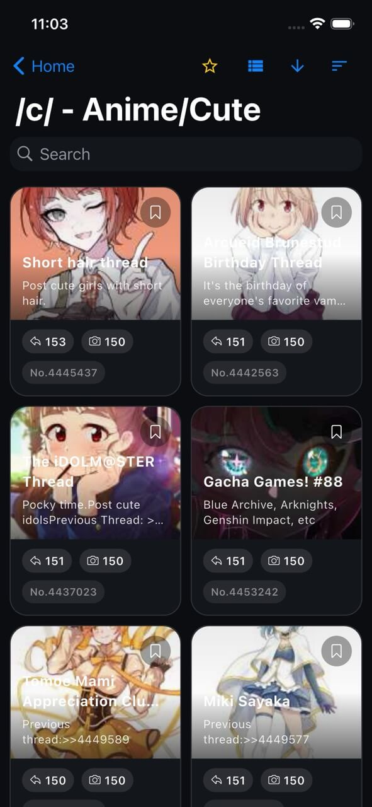
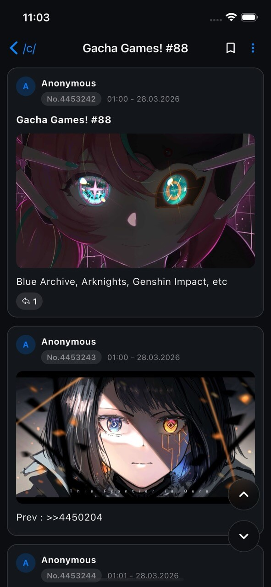
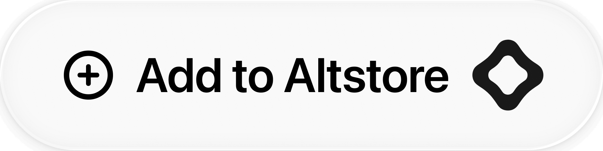
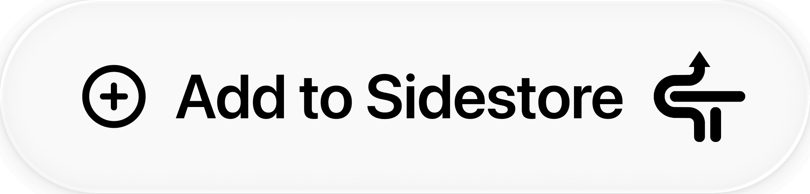

  

<h1 align="center">NekoSurf</h1>

  A fast, private 4chan app for iPhone and Android.

  
  

  
  

## Download

**iPhone:** join the [TestFlight beta](https://testflight.apple.com/join/ky5bRwMY), or add NekoSurf to AltStore or SideStore:

<a href="https://altdirect.app/?url=https://raw.githubusercontent.com/NekoSurf/NekoSurf/refs/heads/main/source.json&r=altstore">
  <picture>
    <source media="(prefers-color-scheme: dark)" srcset="assets/icons/altstore_dark.png">
    <source media="(prefers-color-scheme: light)" srcset="assets/icons/altstore_light.png">
    
  </picture>
</a>
<a href="https://altdirect.app/?url=https://raw.githubusercontent.com/NekoSurf/NekoSurf/refs/heads/main/source.json&r=sidestore">
  <picture>
    <source media="(prefers-color-scheme: dark)" srcset="assets/icons/sidestore_dark.png">
    <source media="(prefers-color-scheme: light)" srcset="assets/icons/sidestore_light.png">
    
  </picture>
</a>

**Android:** [download the APK](https://github.com/NekoSurf/NekoSurf/releases/latest/download/app-arm64-v8a-release.apk) for most phones, or pick the one for yours from the [latest release](https://github.com/NekoSurf/NekoSurf/releases/latest).

## Features

### 🧭 Browse

- All boards in one place, your favorites first, and a Feed of threads from all of them
- Threads in a grid or a list, sorted by bump order, newest, oldest, replies or images
- Search your favorite boards, or all of 4chan
- Hide threads by keyword or regex, and paste a 4chan link to open its thread

### 📖 Read

- Replies nested under the post they answer
- Bookmarks that show when a thread is archived or deleted
- Threads can open where you left off, and a history keeps the ones you visited

### 🎬 Watch and save

- Videos (WebM and MP4) start quickly, even on a slow connection, and play as you scroll
- A fullscreen gallery to swipe through a thread's images and videos, zoom, scrub and change the speed
- Save to the Saved tab or to Photos, or share, several at once, with a ring showing how far along each is
- Reverse image search with Google Lens, Bing, Yandex or SauceNAO

### 🔒 Private

- No account, no ads, no analytics: NekoSurf talks to 4chan, and to GitHub to check for updates
- Your favorites, bookmarks, history and saved files stay on your phone
- NSFW boards stay hidden until you turn them on

  

## License

NekoSurf is free software under the [GPL-3.0](LICENSE).
