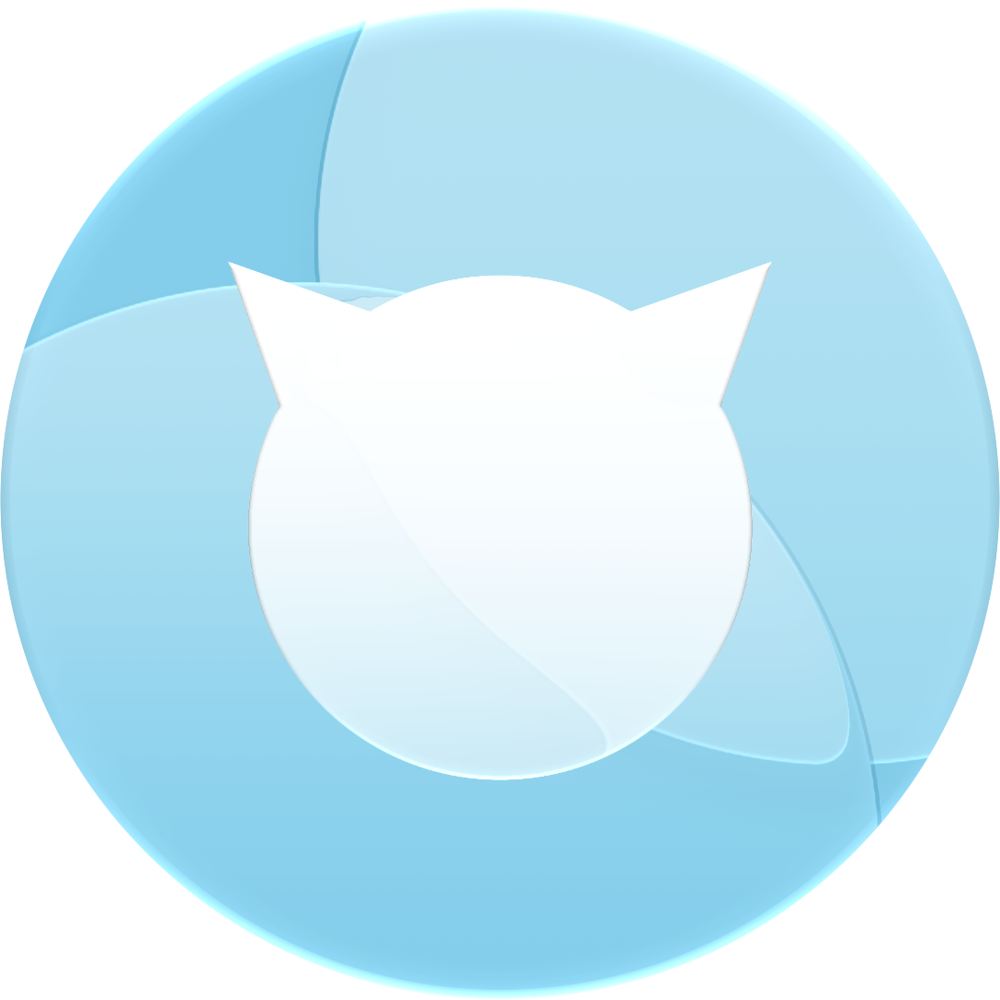
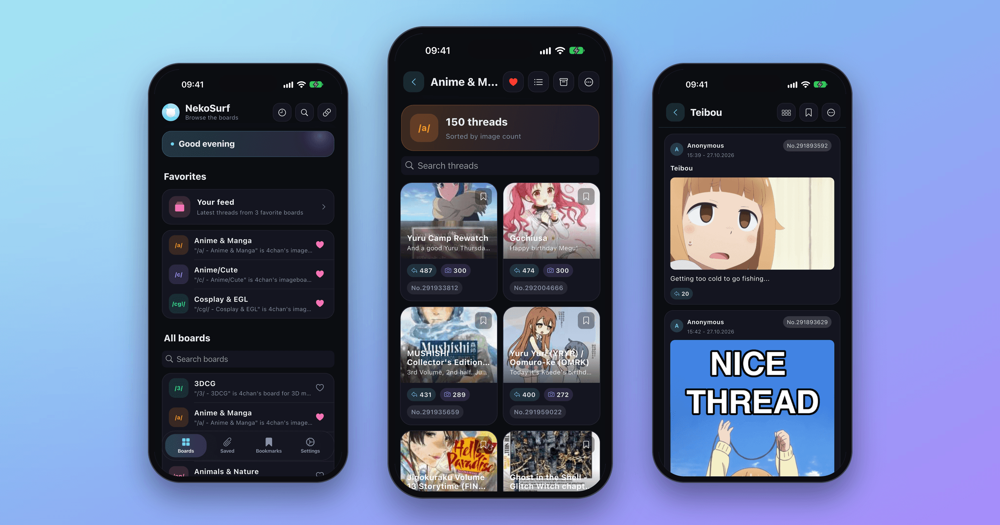
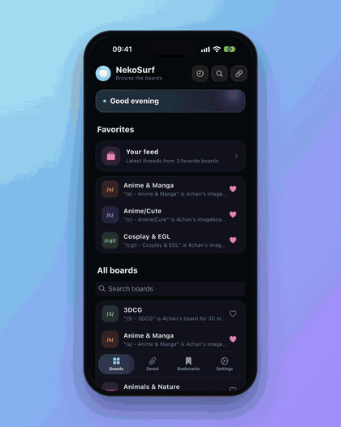

<p align="center">
  
</p>

<h1 align="center">NekoSurf</h1>

<p align="center">
  A fast, private 4chan app for iPhone and Android.
</p>

<p align="center">
  <a href="https://github.com/NekoSurf/NekoSurf/releases/latest"></a>
  <a href="LICENSE"></a>
</p>

<p align="center">
  
</p>

## Download

**iPhone:** join the [TestFlight beta](https://testflight.apple.com/join/ky5bRwMY), or sideload it with AltStore, SideStore, Feather or LiveContainer:

<h3>
<a href="https://altdirect.app/?url=https://raw.githubusercontent.com/NekoSurf/NekoSurf/refs/heads/main/source.json"></a>
&nbsp;
<a href="https://github.com/NekoSurf/NekoSurf/releases/latest/download/Runner.ipa"></a>
</h3>

**Android:** [download the APK](https://github.com/NekoSurf/NekoSurf/releases/latest/download/app-arm64-v8a-release.apk) for most phones, or pick the one for yours from the [latest release](https://github.com/NekoSurf/NekoSurf/releases/latest).

## Features

### 🧭 Browse

- All boards in one place, your favorites first, and a Feed of threads from all of them
- Threads in a grid or a list, sorted by bump order, newest, oldest, replies or images
- Search your favorite boards, or all of 4chan
- Hide threads by keyword or regex, and paste a 4chan link to open its thread

### 📖 Read

- Threads read like comments: replies nested under the post they answer, and folded away with a tap; or a flat list in the order they were posted, if you prefer
- Hold a post to hide it, or a poster's posts by their ID, name, tripcode or country, and filter replies by keyword or regex
- Tap a poster's ID to see all their posts in the thread
- Bookmarks that show when a thread is archived or deleted
- Threads can open where you left off, with what you haven't read counted and new replies marked until you've seen them, and a history keeps the ones you visited
- Swipe right anywhere on a page to go back

### 🎬 Watch and save

- Videos (WebM and MP4) start quickly, even on a slow connection, and play as you scroll
- A fullscreen gallery to swipe through a thread's images and videos, zoom, scrub and change the speed
- A grid of a thread's media that you can narrow to only images or only videos
- Save to the Saved tab or to Photos, or share, several at once, with a ring showing how far along each is
- Reverse image search with Google Lens, Bing, Yandex or SauceNAO
- Turn on iCloud sync to keep your saved media, bookmarks, history, favorite boards, filters and settings the same on your iPhone and iPad, and get them back after reinstalling; or back them up to a file

### 🎨 Make it yours

- Light, dark or following your phone, in 15 color themes that tint the whole app, or pure black for OLED screens

### 🔒 Private

- No account, no ads, no analytics: NekoSurf talks to 4chan, and to GitHub to check for updates
- Your favorites, bookmarks, history and saved files stay on your phone
- NSFW boards stay hidden until you turn them on

The [privacy policy](privacy_policy.md) has the details.

<p align="center">
  
</p>

## Build it yourself

With [Flutter](https://docs.flutter.dev/get-started/install) 3.47.9 (building for iPhone needs a Mac with Xcode):

```sh
git clone https://github.com/NekoSurf/NekoSurf.git
cd NekoSurf
flutter pub get
flutter run
```

Found a bug or have an idea? [Open an issue](https://github.com/NekoSurf/NekoSurf/issues).

## License

NekoSurf is free software under the [GPL-3.0](LICENSE).
